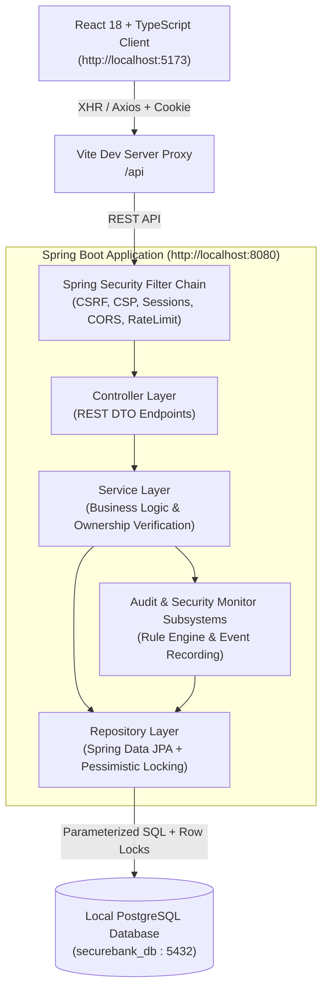
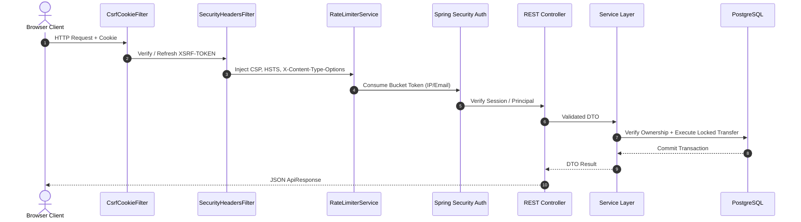

# SecureBank — System Architecture & Design Document

---

## 1. High-Level Architecture Overview

SecureBank is architected as a decoupled, multi-layered financial web application running entirely in a secure local development environment.



---

## 2. Layered Backend Architecture

The backend strictly separates responsibilities across dedicated layers:

```
com.securebank
├── config         # Spring configuration beans
├── controller     # REST API presentation layer (DTO mapping, HTTP status codes)
├── dto            # Data Transfer Objects with Jakarta Bean Validation annotations
├── entity         # JPA relational domain models mapped to PostgreSQL tables
├── exception      # Centralized exception hierarchy and RestControllerAdvice
├── repository     # Spring Data JPA repositories with parameterized queries & locking
├── security       # Authentication providers, AES encryption, TOTP, and security filters
├── service        # Transactional business logic, ledger rules, and access control
└── util           # Cryptographic utilities, account masking, and IP resolution
```

### Component Responsibilities

1. **Controller Layer:**
   - Accepts validated DTOs (`@Valid`).
   - Delegates business logic to service layer.
   - Enforces method-level security (`@PreAuthorize("hasRole('ADMIN')")`).
   - Never exposes internal database entities directly over the API.

2. **Service Layer:**
   - Enforces **Insecure Direct Object Reference (IDOR)** prevention by resolving the authenticated user from `SecurityContextHolder`.
   - Executes double-entry ledger bookkeeping.
   - Enforces business rules (limits, non-negative amounts, duplicate prevention).
   - Coordinates with `AuditService` and `SecurityMonitoringService`.

3. **Repository Layer:**
   - Employs Spring Data JPA parameterized queries to guarantee immunity against SQL injection.
   - Uses `@Lock(LockModeType.PESSIMISTIC_WRITE)` for concurrency control during account balance mutations.

4. **Exception Handling Layer:**
   - Centralized `GlobalExceptionHandler` intercepts exceptions and formats uniform `ApiResponse` envelopes.
   - Strips internal database stack traces to prevent sensitive information disclosure.

---

## 3. Financial Transaction & Ledger Integrity

Financial transactions must be **ACID-compliant**, **auditable**, and **immune to race conditions**.

### Double-Entry Accounting
Every funds transfer creates an immutable transaction record accompanied by two balancing ledger entries:

$$\Delta \text{Balance}_{\text{Source}} = -\text{Amount} \quad (\text{DEBIT})$$
$$\Delta \text{Balance}_{\text{Destination}} = +\text{Amount} \quad (\text{CREDIT})$$
$$\sum \text{Debits} = \sum \text{Credits}$$

### Deadlock-Free Pessimistic Locking
In concurrent banking environments, two accounts transferring money to each other simultaneously could produce a database deadlock:
- Thread 1: Lock Account A $\rightarrow$ Attempt Lock Account B
- Thread 2: Lock Account B $\rightarrow$ Attempt Lock Account A

SecureBank eliminates deadlocks by enforcing **deterministic lock acquisition ordering** based on account IDs:

```java
// TransferService.java
Long firstLockId = Math.min(sourceAccount.getId(), destAccount.getId());
Long secondLockId = Math.max(sourceAccount.getId(), destAccount.getId());

BankAccount lockedFirst = bankAccountRepository.findByIdWithLock(firstLockId);
BankAccount lockedSecond = bankAccountRepository.findByIdWithLock(secondLockId);
```

Regardless of which account is the sender or receiver, both threads acquire locks in the exact same order ($1 \rightarrow 2$), mathematically preventing circular wait conditions.

### Idempotency Protection
Clients generate a client-side UUID (`idempotencyKey`). If a duplicate request is received with the same key, `TransferService` immediately returns the existing completed transaction without re-debiting the sender.

---

## 4. Security Filter Chain Flow



---

## 5. Session & State Architecture

1. **Server-Side Sessions:**
   - Sessions are managed by the Spring Boot servlet container.
   - Authenticated session identifier stored in `SECUREBANKSESSIONID` cookie.
   - `HttpOnly: true` (JavaScript cannot read the session identifier).
   - `SameSite: Lax` (prevents cross-site credential leakage).
2. **Session Fixation Defense:**
   - Upon successful login, Spring Security invokes `migrateSession()`, destroying the pre-authentication session ID and issuing a fresh cryptographically random session identifier.
3. **Session Invalidation:**
   - Explicit logout immediately clears the SecurityContext, invalidates the HTTP session on the server, and marks the record inactive in the `user_sessions` database table.
