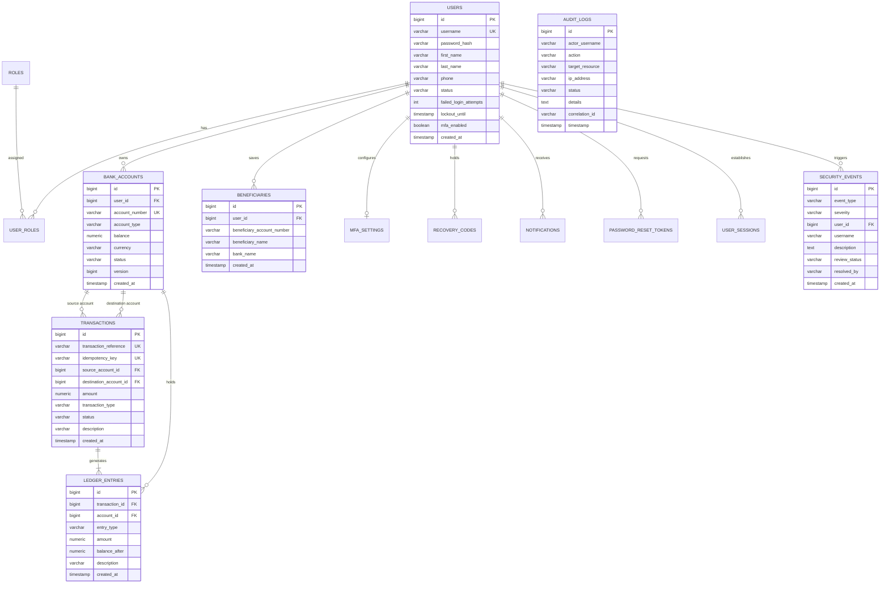

# SecureBank — Database Schema & Design Specification

**Database Engine:** PostgreSQL 18  
**Database Name:** `securebank_db`  
**Migration Tool:** Flyway (SQL Versioned Migrations)

---

## 1. Entity-Relationship (ER) Diagram

---

## 2. Table Specifications & Constraints

### 1. `roles`
Stores role-based access control definitions (`ROLE_CUSTOMER`, `ROLE_ADMIN`).
- `id` (BIGSERIAL, PRIMARY KEY)
- `name` (VARCHAR(50), NOT NULL, UNIQUE)

### 2. `users`
Core customer and administrator authentication entities.
- `id` (BIGSERIAL, PRIMARY KEY)
- `username` (VARCHAR(255), NOT NULL, UNIQUE) — Lowercase email identifier
- `password_hash` (VARCHAR(255), NOT NULL) — BCrypt hash (cost factor 12)
- `first_name` (VARCHAR(100), NOT NULL)
- `last_name` (VARCHAR(100), NOT NULL)
- `phone` (VARCHAR(30))
- `status` (VARCHAR(30), NOT NULL, DEFAULT 'ACTIVE') — `ACTIVE`, `SUSPENDED`, `LOCKED`
- `failed_login_attempts` (INT, NOT NULL, DEFAULT 0)
- `lockout_until` (TIMESTAMP WITH TIME ZONE) — Account lock expiry
- `mfa_enabled` (BOOLEAN, NOT NULL, DEFAULT FALSE)
- `created_at` (TIMESTAMP WITH TIME ZONE, NOT NULL)
- `updated_at` (TIMESTAMP WITH TIME ZONE, NOT NULL)

### 3. `user_roles`
Many-to-many relationship mapping users to authorities.
- `user_id` (BIGINT, FK -> users(id) ON DELETE CASCADE)
- `role_id` (BIGINT, FK -> roles(id) ON DELETE CASCADE)
- PRIMARY KEY (`user_id`, `role_id`)

### 4. `bank_accounts`
Customer checking and savings financial accounts.
- `id` (BIGSERIAL, PRIMARY KEY)
- `user_id` (BIGINT, FK -> users(id) ON DELETE RESTRICT)
- `account_number` (VARCHAR(32), NOT NULL, UNIQUE)
- `account_type` (VARCHAR(30), NOT NULL) — `SAVINGS`, `CURRENT`
- `balance` (NUMERIC(19, 4), NOT NULL, DEFAULT 0.0000)
- `currency` (VARCHAR(10), NOT NULL, DEFAULT 'INR')
- `status` (VARCHAR(30), NOT NULL, DEFAULT 'ACTIVE') — `ACTIVE`, `FROZEN`, `CLOSED`
- `version` (BIGINT, NOT NULL, DEFAULT 0) — Optimistic locking token
- `created_at`, `updated_at` (TIMESTAMP WITH TIME ZONE)
- **Constraint:** `chk_positive_balance CHECK (balance >= 0)` (Enforces at database level that accounts cannot overdraft into negative balances)

### 5. `beneficiaries`
Saved external or internal transfer recipients.
- `id` (BIGSERIAL, PRIMARY KEY)
- `user_id` (BIGINT, FK -> users(id) ON DELETE CASCADE)
- `beneficiary_account_number` (VARCHAR(32), NOT NULL)
- `beneficiary_name` (VARCHAR(100), NOT NULL)
- `bank_name` (VARCHAR(100), NOT NULL, DEFAULT 'SecureBank')
- `email`, `nickname` (VARCHAR)
- `created_at` (TIMESTAMP WITH TIME ZONE)
- **Constraint:** `uq_user_beneficiary UNIQUE (user_id, beneficiary_account_number)` (Prevents duplicate entries per user)

### 6. `transactions`
Parent financial transaction records.
- `id` (BIGSERIAL, PRIMARY KEY)
- `transaction_reference` (VARCHAR(64), NOT NULL, UNIQUE)
- `idempotency_key` (VARCHAR(128), UNIQUE)
- `source_account_id` (BIGINT, FK -> bank_accounts(id))
- `destination_account_id` (BIGINT, FK -> bank_accounts(id))
- `amount` (NUMERIC(19, 4), NOT NULL)
- `currency` (VARCHAR(10), NOT NULL, DEFAULT 'INR')
- `transaction_type` (VARCHAR(30), NOT NULL) — `TRANSFER`, `DEPOSIT`, `WITHDRAWAL`
- `status` (VARCHAR(30), NOT NULL) — `COMPLETED`, `FAILED`, `PENDING`
- `description`, `failure_reason` (VARCHAR(255))
- `created_at` (TIMESTAMP WITH TIME ZONE)
- **Constraint:** `chk_positive_amount CHECK (amount > 0)`

### 7. `ledger_entries`
Double-entry bookkeeping audit table.
- `id` (BIGSERIAL, PRIMARY KEY)
- `transaction_id` (BIGINT, NOT NULL, FK -> transactions(id) ON DELETE CASCADE)
- `account_id` (BIGINT, NOT NULL, FK -> bank_accounts(id))
- `entry_type` (VARCHAR(10), NOT NULL) — `DEBIT` or `CREDIT`
- `amount` (NUMERIC(19, 4), NOT NULL)
- `balance_after` (NUMERIC(19, 4), NOT NULL)
- `description` (VARCHAR(255))
- `created_at` (TIMESTAMP WITH TIME ZONE)
- **Constraint:** `chk_ledger_positive_amount CHECK (amount > 0)`

### 8. `mfa_settings`
Encrypted TOTP secret storage.
- `id` (BIGSERIAL, PRIMARY KEY)
- `user_id` (BIGINT, NOT NULL, UNIQUE, FK -> users(id) ON DELETE CASCADE)
- `secret_key_encrypted` (VARCHAR(512), NOT NULL) — AES-256-GCM cipher with IV
- `is_verified` (BOOLEAN, NOT NULL, DEFAULT FALSE)
- `created_at`, `updated_at` (TIMESTAMP WITH TIME ZONE)

### 9. `recovery_codes`
Hashed one-time backup recovery codes for 2FA account restoration.
- `id` (BIGSERIAL, PRIMARY KEY)
- `user_id` (BIGINT, NOT NULL, FK -> users(id) ON DELETE CASCADE)
- `code_hash` (VARCHAR(255), NOT NULL) — BCrypt hash of 8-character recovery code
- `used` (BOOLEAN, NOT NULL, DEFAULT FALSE)
- `used_at` (TIMESTAMP WITH TIME ZONE)

### 10. `login_attempts`
Audited record of all authentication attempts.
- `id` (BIGSERIAL, PRIMARY KEY)
- `email` (VARCHAR(255), NOT NULL)
- `ip_address` (VARCHAR(64))
- `user_agent` (VARCHAR(255))
- `success` (BOOLEAN, NOT NULL)
- `failure_reason` (VARCHAR(255))
- `attempt_time` (TIMESTAMP WITH TIME ZONE)

### 11. `audit_logs`
Immutable forensic audit trail.
- `id` (BIGSERIAL, PRIMARY KEY)
- `actor_username` (VARCHAR(255), NOT NULL)
- `action` (VARCHAR(100), NOT NULL)
- `target_resource` (VARCHAR(100))
- `ip_address` (VARCHAR(64))
- `status` (VARCHAR(30), NOT NULL) — `SUCCESS`, `FAILURE`, `WARNING`
- `details` (TEXT)
- `correlation_id` (VARCHAR(64))
- `timestamp` (TIMESTAMP WITH TIME ZONE)

### 12. `security_events`
Rule engine flagged anomaly detections.
- `id` (BIGSERIAL, PRIMARY KEY)
- `event_type` (VARCHAR(100), NOT NULL)
- `severity` (VARCHAR(20), NOT NULL) — `LOW`, `MEDIUM`, `HIGH`, `CRITICAL`
- `user_id` (BIGINT, FK -> users(id) ON DELETE SET NULL)
- `username` (VARCHAR(255))
- `description` (TEXT, NOT NULL)
- `review_status` (VARCHAR(30), NOT NULL, DEFAULT 'NEW')
- `resolved_by` (VARCHAR(255))
- `created_at` (TIMESTAMP WITH TIME ZONE)

### 13. `notifications`
Customer and system alerts.
- `id` (BIGSERIAL, PRIMARY KEY)
- `user_id` (BIGINT, NOT NULL, FK -> users(id) ON DELETE CASCADE)
- `title` (VARCHAR(150), NOT NULL)
- `message` (TEXT, NOT NULL)
- `type` (VARCHAR(30), NOT NULL) — `SECURITY`, `TRANSACTION`, `ACCOUNT`, `SYSTEM`
- `is_read` (BOOLEAN, NOT NULL, DEFAULT FALSE)
- `created_at` (TIMESTAMP WITH TIME ZONE)

### 14. `password_reset_tokens`
Cryptographically random single-use tokens for password recovery.
- `id` (BIGSERIAL, PRIMARY KEY)
- `user_id` (BIGINT, NOT NULL, FK -> users(id) ON DELETE CASCADE)
- `token_hash` (VARCHAR(255), NOT NULL, UNIQUE) — SHA-256 hash of random token
- `expiry_date` (TIMESTAMP WITH TIME ZONE, NOT NULL)
- `used` (BOOLEAN, NOT NULL, DEFAULT FALSE)
- `created_at` (TIMESTAMP WITH TIME ZONE)

### 15. `user_sessions`
Active session tracking table.
- `id` (BIGSERIAL, PRIMARY KEY)
- `session_id` (VARCHAR(128), NOT NULL, UNIQUE)
- `user_id` (BIGINT, NOT NULL, FK -> users(id) ON DELETE CASCADE)
- `ip_address` (VARCHAR(64))
- `user_agent` (VARCHAR(255))
- `last_activity` (TIMESTAMP WITH TIME ZONE)
- `is_active` (BOOLEAN, NOT NULL, DEFAULT TRUE)
- `created_at` (TIMESTAMP WITH TIME ZONE)

---

## 3. Monetary Precision & Rounding Strategy

All currency fields use `NUMERIC(19, 4)` and Java `BigDecimal`:
- 15 digits of integer capacity (up to 999,999,999,999,999).
- 4 decimal digits of precision for internal fractional rounding.
- Never use IEEE 754 floating-point (`float`, `double`) for financial calculations to prevent floating-point rounding errors.
- Client transfers are strictly validated to at most 2 decimal places (`@Digits(integer = 15, fraction = 2)`).
